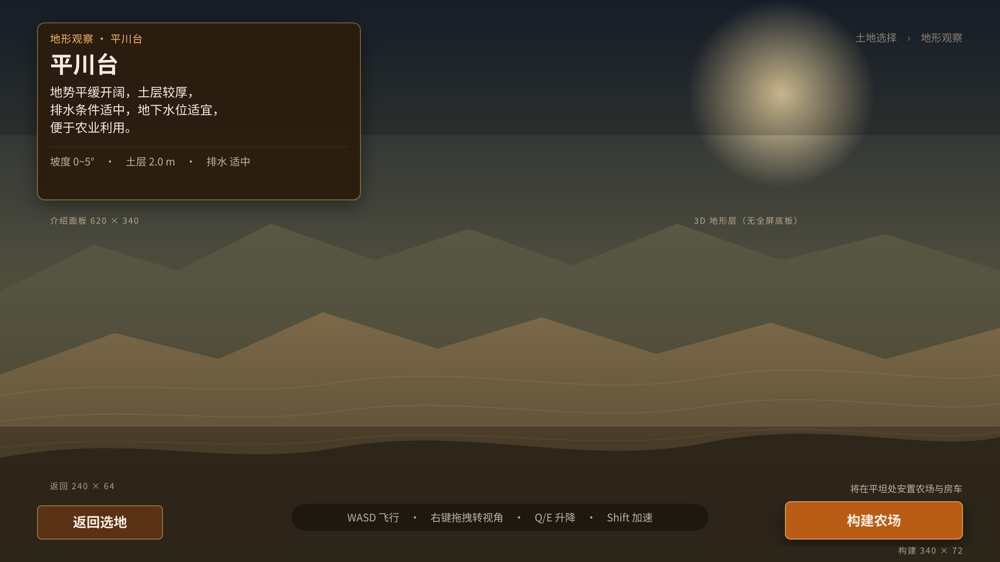

# 地形观察页 UI 改动清单

> ⚠️ **2026-10-31 状态**：程序化地形实现已暂时删除，先改用 Unity Terrain 刷。本文保留作 UI 改动参考；`LandPreviewScreen`、`LoadingOverlay`、`LandPreviewUiPatcher` 等 UI 壳仍然保留，但不再生成地形。
>
> 日期：2026-10-31
> 范围：土地类型选择 → 地形观察 → 构建农场/加载 → 土地基础数据设置
> 关联：[地形观察与无限地形实现方案.md](地形观察与无限地形实现方案.md)
> 本文只整理 **UI 要改什么**，不含高度场/网格/相机算法的实现细节。

---

## 0. 一页速览

| # | 改什么 | 类型 | 优先级 |
|---|---|---|---|
| 1 | `Screen_LandSelect`：副标题、备注、四张卡全部开放 | 改现有 | P0 |
| 2 | 四张卡的「选择」按钮：去掉旧 `PlaceholderScreen` 动作，改挂 `OptionCardButton` | 改现有 | P0 |
| 3 | 新增 `Screen_LandPreview`：左上介绍面板 + 右下「构建农场」+ 左下返回 + 操作提示 | 新增 | P0 |
| 4 | 新增 `LoadingOverlay`：全屏构建动画 + 进度条 + 状态文字 | 新增 | P0 |
| 5 | `Screen_LandParams`：加半透明底板，保证在农场背景上可读 | 改现有 | P1 |
| 6 | `Screen_Confirm`：更新「确认后进入农场」的说明文案 | 改现有 | P1 |
| 7 | `GameState` 追加 `LandPreview = 10`；`GameFlowController` 注册新屏、处理输入策略 | 改代码 | P0 |
| 8 | 卡片选中态：四张卡现在套皮后长得一样，需要「已选」标记 | 改现有 | P1 |
| 9 | 编辑器补丁脚本 `LandPreviewUiPatcher`：把以上改动幂等地写进 `UI.unity` | 新增 | P0 |

**一句话原则：不重跑全量白盒构建。** 现有 `UI.unity` 在构建后已经手工改过（例如 FarmStage 的 `ViewPlaceholder` 被删掉、皮肤已套用），重建会把这些手工改动覆盖掉。用一次性补丁脚本改现有场景。

---

## 1. 现状

### 1.1 画布与屏

| 项 | 现状 |
|---|---|
| 场景 | `Assets/Scenes/UI.unity` |
| 根节点 | `UI_Root` |
| 画布 | `UI_Root/Screen_Canvas`，Screen Space - Overlay |
| 参考分辨率 | 1920 × 1080，`CanvasScaler.ScaleWithScreenSize`，`matchWidthOrHeight = 0.5` |
| 屏容器 | `UI_Root/Screen_Canvas/Screens` |
| 状态机 | `UI_Root/UI_Flow` 上的 `GameFlowController` |
| 转场 | `UI_Flow` 上的 `ScreenTransitionPlayer`，当前样式 `Push`，时长 0.45 s |
| 点击反馈 | `UI_Flow` 上的 `UiClickFeedback`，点击后先播放 0.4 s 左右的收起动画 |
| 皮肤 | `UiSkin`，构建时默认自动套 EPS 素材；卡片/按钮的 `Image.color` 已统一成白色，由 sprite 决定外观 |

### 1.2 当前屏列表

`GameFlowController.screens` 里已有 10 个屏：

```
Screen_Welcome
Screen_Intro
Screen_LandSelect
Screen_LandParams
Screen_PlantSelect
Screen_Confirm
Screen_FarmStage
Screen_RobotCruise
Screen_Analyze
Screen_Revenue
```

### 1.3 `Screen_LandSelect` 现有层级

```
Screen_LandSelect
├── Header
│   ├── Title          "土地类型选择"
│   ├── Subtitle       "四块地横排；点卡片下方按钮选择，左下角返回上一步。"
│   └── Divider
├── Body
│   ├── LandCards
│   │   ├── Cell_Land1
│   │   │   └── Card_Land1
│   │   │       ├── Badge        "土地类型 1"
│   │   │       ├── Title        "平川台"
│   │   │       ├── Description  "地势平缓开阔，土层较厚……"
│   │   │       └── Button_Select
│   │   │           └── Label    "选择"
│   │   ├── Cell_Land2 → Button_Locked "暂未开放"
│   │   ├── Cell_Land3 → Button_Locked "暂未开放"
│   │   └── Cell_Land4 → Button_Locked "暂未开放"
│   └── Note           "备注：目前只能选择一个平川台。"
└── Footer
    └── Button_Back    "上一步返回"
```

布局：四列等分，卡片区高 470 px，卡片内边距 24 px，按钮高 60 px，左右外边距 72 px。

### 1.4 现在点「选择」会发生什么

`Screen_LandSelect` 的 `PlaceholderScreen.actions` 序列化内容是：

| 按钮 | kind | target | 说明 |
|---|---|---|---|
| Card_Land1/Button_Select | `GoTo` | `LandParams` (3) | 直接进土地参数 |
| Card_Land2/Button_Locked | `LogOnly` | — | 只打日志「泽洼域 目前仍是白盒」 |
| Card_Land3/Button_Locked | `LogOnly` | — | 只打日志 |
| Card_Land4/Button_Locked | `LogOnly` | — | 只打日志 |
| Footer/Button_Back | `Back` | — | 返回上一步 |

也就是说：**四张卡的按钮其实都 `interactable = true`**，只是后三张点下去只打日志；而且卡 1 已经有一条「直接去 LandParams」的动作。

### 1.5 现有 UI 的坑（这次改动必须先处理）

| # | 坑 | 后果 |
|---|---|---|
| U1 | 四张卡都 `interactable`，后三张只 `LogOnly` | 玩家点「暂未开放」没反应，像坏按钮 |
| U2 | 卡 1 已有 `GoTo LandParams` 的旧动作 | 如果再挂 `OptionCardButton`，两个监听会同时触发；旧动作先注册，通常先执行，于是**还是去了 LandParams**，不是观察页 |
| U3 | `UiWhiteboxBuilder` 里 `MakeButton(..., enabled)` 只把 `enabled` 传给了 `primary`，从未设 `Button.interactable` | 后三张「暂未开放」按钮实际仍可点，只是点了打日志 |
| U4 | 套皮后四张卡用同一张卡面 sprite、`Image.color = 白色` | 卡面本身分不出哪张被选中，需要额外文字/描边提示 |
| U5 | 全量重建会重新加回 `FarmStage/ViewPlaceholder` 等已被手工删掉的对象 | 可能把 3D 农场画面重新盖住 |
| U6 | `GameState` 是按 int 序列化在场景里的 | 新状态只能追加，不能插在中间 |
| U7 | `FarmCameraRig` 的 `LateUpdate` 即使 `SetInputEnabled(false)` 也会重算位置 | 预览相机若只关输入，会被农场相机抢 Transform；构建后还会从 5 km 外滑回农场 |
| U8 | `OptionCardButton` 和旧 `ScreenAction` 都会调用 `UiClickFeedback.Play` | 双重反馈、双重跳转；`UiClickFeedback.Busy` 会把第二个吞掉，结果取决于监听注册顺序 |
| U9 | `LandParams` 没有底板，现在盖在深色占位背景上；改到农场背景上后文字对比度可能不够 | 表单看不清 |
| U10 | `ConfirmNote` 还写着「确认后进入第三人称视角农场」 | 新流程里农场在构建时已经出现，文案会显得重复 |

---

## 2. 目标流程与页面清单

### 2.1 建议流程

```
Welcome → Intro → LandSelect
                        │ 点「选择」
                        ▼
                  LandPreview（新）
                        │ 点「构建农场」
                        ▼
                  LoadingOverlay（新，非状态）
                        │
                        ▼
                  LandParams → PlantSelect → Confirm → FarmStage → RobotCruise → Analyze → Revenue
```

另一种不改屏顺序的方案：

```
LandSelect → LandParams → PlantSelect → Confirm → LandPreview → FarmStage
```

但这样「选地」和「看地」隔了三屏，体验不连贯。**本文按第一种写**；如果最终选第二种，只需要把 `LandPreview` 的 `targetState` 从 `LandParams` 改成 `FarmStage`，其余 UI 不变。

### 2.2 页面职责

| 页面 | 背景 | 相机 | 输入 | 主要 UI |
|---|---|---|---|---|
| `LandSelect` | 纯 UI（现有） | 无 | UI | 四张卡 + 选择 + 返回 |
| `LandPreview` | 3D 地形（程序化） | 同农场相机，临时由飞行相机控制 | WASD / 右键 / QE / Shift | 左上介绍、右下构建、左下返回、底部操作提示 |
| `LoadingOverlay` | 全屏黑 | 无 | 阻断 | 标题 + 进度条 + 状态 |
| `LandParams` | 3D 农场（构建后） | 农场相机（不接收输入） | UI | 现有六项表单 + 返回 |
| `PlantSelect` | 3D 农场 | 农场相机（不接收输入） | UI | 现有四张卡 |
| `Confirm` | 3D 农场 | 农场相机（不接收输入） | UI | 现有确认面板 |
| `FarmStage` | 3D 农场 | 农场相机（可操作） | 相机 | 现有 HUD，不改布局 |

> `LoadingOverlay` **不是** `GameState`，不参与状态机；它是 `Screen_Canvas` 下的一层常驻 Overlay。

---

## 3. `Screen_LandSelect` 改动

### 3.1 文案改动

| 对象路径 | 现在 | 改成 |
|---|---|---|
| `Screen_LandSelect/Header/Subtitle` | 四块地横排；点卡片下方按钮选择，左下角返回上一步。 | 四块地横排；点「选择」进入地形观察，左下角返回上一步。 |
| `Screen_LandSelect/Body/Note` | 备注：目前只能选择一个平川台。 | 备注：四块地都可观察；选好地形后点「构建农场」，再进入参数设置。 |

> 如果这次也修 `崇岭阶` 的文案，`UiContent.LandIntros[2]` 的「坡度超过高」建议改为「坡度较高」；这是策划原文疑似笔误，改之前先确认。

### 3.2 四张卡片

| 卡 | 节点 | `optionId` | `displayName` | 按钮当前名 | 按钮改成 | 目标状态 |
|---|---|---|---|---|---|---|
| 1 | `Body/LandCards/Cell_Land1/Card_Land1` | `flat_plain` | 平川台 | `Button_Select` | `Button_Select` / 文案「选择」 | `LandPreview` |
| 2 | `.../Cell_Land2/Card_Land2` | `low_wetland` | 泽洼域 | `Button_Locked` | `Button_Select` / 文案「选择」 | `LandPreview` |
| 3 | `.../Cell_Land3/Card_Land3` | `steep_ridge` | 崇岭阶 | `Button_Locked` | `Button_Select` / 文案「选择」 | `LandPreview` |
| 4 | `.../Cell_Land4/Card_Land4` | `plateau` | 高原坪 | `Button_Locked` | `Button_Select` / 文案「选择」 | `LandPreview` |

每张卡的按钮要：

1. `Button.interactable = true`。
2. 子节点 `Label` 的 TMP 文本改成「选择」。
3. 挂 `OptionCardButton`：
   - `category = Land`
   - `optionId` / `displayName` 按上表
   - `targetState = GameState.LandPreview`
   - `description` 可填卡片简介，便于排查
4. **删除** `PlaceholderScreen.actions` 里这张卡对应的旧动作（卡 1 的 `GoTo LandParams`、卡 2~4 的 `LogOnly`）。
5. 保留 `Footer/Button_Back` 的 `Back` 动作，不要动。

> 第 4 步是这次改动的关键。只加 `OptionCardButton` 不删旧动作，会变成「两个监听抢一次点击」，见 U2/U8。

### 3.3 选中态

套皮后四张卡视觉完全一样，必须补一个「已选」标记，否则玩家返回选地页时不知道自己刚才选了哪块。

建议做法（成本最低、不依赖新素材）：

- 每张卡的右上角加一个 TMP 文本 `SelectedTag`：
  - 位置：`TopBand(24, 20, 24, 28)`，右对齐
  - 字号 20，颜色 `UiTheme.TextAccent`
  - 文案：「● 已选」
  - 默认 `SetActive(false)`
- 新增 `LandSelectHighlighter` 组件挂在 `Screen_LandSelect` 上：
  - 序列化四个 `TMP_Text selectedTags`
  - `OnEnable` 时读 `GameFlowController.Context.LandTypeId`，映射到 0~3，只点亮对应 tag
  - 兼容 `pingchuantai` / `flat_plain`、`zewayu` / `low_wetland` 等新旧 id
- 不建议只靠改卡片底色：套皮后卡片由 sprite 决定外观，`Image.color` 只能整体染色，选中态不够明显；也不建议只靠颜色区分（可访问性差）。

### 3.4 布局

四列布局、卡片尺寸、按钮位置**都不动**：

```
Body 宽 1776（1920 − 72 × 2）
4 列，列间距 32
单卡宽约 420，卡片高 470
按钮：左右内边距 24，底部 24，高 60
```

只改按钮文案和交互，不调整布局，避免影响其它屏的栅格。

---

## 4. `Screen_LandPreview` 新增

### 4.1 线框图（1920 × 1080 参考）

```
┌────────────────────────────────────────────────────────────────────┐
│ ┌──────────────────────────────┐          土地选择 › 地形观察      │
│ │ 地形观察 · 平川台            │                                    │
│ │ 平川台                        │                                    │
│ │ 地势平缓开阔，土层较厚，      │                                    │
│ │ 排水条件适中，地下水位适宜，  │                                    │
│ │ 便于农业利用。                │                                    │
│ │ 坡度 0~12°  土层 2.0 m  排水 适中 │                                │
│ └──────────────────────────────┘                                    │
│                                                                    │
│                     （3D 地形，无全屏底板）                        │
│                                                                    │
│                                                     将在平坦处安置 │
│                                                     农场与房车     │
│ [返回选地]        WASD 飞行 · 右键转视角 · Q/E 升降      [构建农场] │
└────────────────────────────────────────────────────────────────────┘
```



> 线框图只示意布局与层级，颜色/圆角/描边以 EPS 皮肤为准。

### 4.2 层级树

```
Screen_LandPreview                     （PlaceholderScreen 子类 LandPreviewScreen）
├── IntroPanel                         （Image，UiTheme.PanelBg，UiSkinRole.Panel）
│   ├── Badge                          （TMP，20，TextAccent）
│   ├── Title                          （TMP，44，TextPrimary）
│   ├── Intro                          （TMP，24，TextPrimary）
│   ├── Facts                          （TMP，20，TextSecondary）
│   └── Thumbnail                      （可选，Image/RawImage，地形预览图）
├── Breadcrumb                         （TMP，20，TextMuted，右对齐）
├── ControlHint                        （TMP，20，TextMuted，底部居中）
├── Footer
│   ├── Button_Back                    （Button，240×64，左下）
│   └── BuildGroup
│       ├── BuildHint                  （TMP，18，TextSecondary，右对齐）
│       └── Button_Build               （Button，340×72，主按钮，右下）
└── GeneratingHint                     （可选，生成地形时的「正在生成地形…」）
```

> 根节点必须铺满父级（`UiLayout.Stretch`），因为 `ScreenTransitionPlayer` 会移动整屏；**不要**给根节点加全屏不透明 Image，否则会挡住 3D 地形。

### 4.3 尺寸与样式

| 元素 | 锚点/位置 | 尺寸 | 字号 | 颜色 | 皮肤角色 |
|---|---|---|---|---|---|
| `Screen_LandPreview` | 全屏 Stretch | 1920×1080 | — | — | — |
| `IntroPanel` | 左上 (72, 44) | 620×340 | — | `PanelBg`（α 0.94） | `Panel` |
| `Badge` | TopBand (24, 20, 24, 28) | 572×28 | 20 | `TextAccent` | — |
| `Title` | TopBand (24, 52, 24, 60) | 572×60 | 44 | `TextPrimary` | — |
| `Intro` | TopBand (24, 136, 24, 120) | 572×120 | 24，行距 1.25 | `TextPrimary` | — |
| `Facts` | TopBand (24, 272, 24, 48) | 572×48 | 20 | `TextSecondary` | — |
| `Breadcrumb` | 右上 (72, 44) | 420×40 | 20 | `TextMuted`，右对齐 | — |
| `ControlHint` | 底部居中 (0, 64) | 760×40 | 20 | `TextMuted`，居中 | — |
| `Button_Back` | 左下 (72, 44) | 240×64 | 26 | 普通按钮 | `Button` |
| `BuildHint` | 右下 (72, 124) | 340×28 | 18 | `TextSecondary`，右对齐 | — |
| `Button_Build` | 右下 (72, 44) | 340×72 | 26 | 主按钮 | `ButtonPrimary` |
| `GeneratingHint` | 屏幕中心 (0, 0) | 420×40 | 20 | `TextSecondary`，居中 | — |

补充：

- `IntroPanel` 的 `Image.raycastTarget = true`，挡住面板区域的 3D 点击；根节点和空白区域不挡。
- 底部操作提示不要和「构建农场」按钮重叠：按钮左边界在 1920−72−340 = 1508；提示宽 760，中心在 960，右边界 1340，安全。
- `Intro` 文本最多 3 行；620 宽的 24 号中文约 24 字/行，现有简介 30~40 字，2 行足够。
- `Facts` 建议一条文本，格式「坡度 0~12°　·　土层 2.0 m　·　排水 适中」，用中点分隔；不要做成三个小面板，省空间。

### 4.4 四种地形的文案

`Title`、`Badge` 用显示名；`Intro` 直接复用 `UiContent.LandIntros`；`Facts` 是新增文案，**标为建议值，需策划确认**。

| id | 显示名 | Badge | Intro 来源 | Facts（建议） |
|---|---|---|---|---|
| `flat_plain` / `pingchuantai` | 平川台 | 地形观察 · 平川台 | `LandIntros[0]`：地势平缓开阔，土层较厚，排水条件适中，地下水位适宜，便于农业利用。 | 坡度 0~12°　·　土层 2.0 m　·　排水 适中 |
| `low_wetland` / `zewayu` | 泽洼域 | 地形观察 · 泽洼域 | `LandIntros[1]`：地势低洼，地下水位较高，雨季容易积水，土壤湿度偏大，需做好排水防涝。 | 坡度 0~3°　·　地下水位 高　·　雨季易积水 |
| `steep_ridge` / `chonglingjie` | 崇岭阶 | 地形观察 · 崇岭阶 | `LandIntros[2]`：坡度超过高，土层较薄，地表径流较强，易发生水土流失，需加强植被保护。 | 坡度 15~30°　·　土层 较薄　·　台地 3 m |
| `plateau` / `gaoyuanping` | 高原坪 | 地形观察 · 高原坪 | `LandIntros[3]`：海拔高，气压较低，昼夜温差较大，地势相对平缓，气候较凉爽。 | 海拔 较高　·　昼夜温差 大　·　台顶 平缓 |

> `崇岭阶` 的「坡度超过高」是原文疑似笔误；如果这次顺手改文案，建议改成「坡度较高」，并在提交信息里注明。

### 4.5 `Breadcrumb`

文案：`土地选择 › 地形观察`

- 20 号 `TextMuted`，右对齐。
- 不建议写「3/9」这种步骤号：后面流程还有 `LandParams / PlantSelect / Confirm / FarmStage`，数字会随流程调整而失效。

### 4.6 按钮行为

| 按钮 | 行为 |
|---|---|
| `Button_Back` | 先 `ExitPreview()`（停飞行、恢复农场相机姿态），再 `Flow.Back()` 回 `LandSelect` |
| `Button_Build` | `UiClickFeedback.Play(button, true, StartBuild)` → 显示 `LoadingOverlay` → 构建/切相机 → `Flow.GoTo(LandParams)` |

`LandPreviewScreen` 要 **`OwnsButton` 接管这两个按钮**，不要再往 `PlaceholderScreen.actions` 里加 `GoTo`，否则会重复触发。

### 4.7 进入/退出时顺序（重要）

`ScreenTransitionPlayer` 会把旧屏留到动画播完再 `OnExit`；相机必须在这个空档里处理好，否则会从 5 km 外滑回农场。

**进入 `LandPreview`：**

```
OnEnter:
  1. 读 Flow.Context.LandTypeId，映射到 4 套地形
  2. 填 Badge / Title / Intro / Facts
  3. 保存农场相机当前 position / rotation（savedPose）
  4. FarmCameraRig.enabled = false
  5. TerrainFlyCamera.enabled = true，摆到该地形的出生点
  6. 生成预览地形（可协程；生成期间显示 GeneratingHint）
```

`GameFlowController.ApplyInputPolicy(LandPreview)` 在 `OnEnter` 之后执行，必须 **不要** 重新 `enabled = true` 农场相机，只做：

```csharp
if (state == GameState.LandPreview)
{
    var rig = FindObjectOfType<FarmCameraRig>();
    if (rig != null) { rig.SetInputEnabled(false); rig.enabled = false; }
}
```

**离开 `LandPreview`（返回或构建）：**

```
ExitPreview():
  1. TerrainFlyCamera.enabled = false
  2. 恢复 savedPose（position / rotation）
  3. FarmCameraRig.enabled = true
  4. 销毁/隐藏预览地形根节点
```

- `Button_Back` 在调用 `Flow.Back()` **之前**执行 `ExitPreview()`。
- `Button_Build` 在加载动画结束、调用 `Flow.GoTo(LandParams)` **之前**执行 `ExitPreview()`。
- `OnExit()` 里再调用一次 `ExitPreview()` 作为兜底（幂等）。
- 这样旧屏在转场动画里滑动时，背景已经是农场，不会看到 5 km 的飞行。

### 4.8 生成地形期间的 UI

静态 512 m 高度场生成约 0.2~0.5 s。建议：

- `OnEnter` 先填文案，再启动协程生成。
- 生成期间在 `IntroPanel` 下方或屏幕中心显示 `GeneratingHint`「正在生成地形…」。
- 生成完成后 `SetActive(false)`，再启用飞行输入。
- 不要在生成期间显示全屏黑幕；玩家应该先看到介绍面板和天空。

---

## 5. `LoadingOverlay` 新增

### 5.1 位置

```
UI_Root/Screen_Canvas/
├── Screens/                 （现有 10 屏 + Screen_LandPreview）
└── OverlayLayer/            （新增）
    └── LoadingOverlay       （新增，初始 inactive）
```

- `OverlayLayer` 是 `Screens` 的兄弟节点，放在后面，天然盖在所有屏之上。
- 不要让 `LoadingOverlay` 成为某个屏的子节点：`ScreenTransitionPlayer` 会移动整个屏，加载层会跟着滑走。
- `LoadingOverlay` 不要挂 `PlaceholderScreen`，它不属于状态机。

### 5.2 层级

```
LoadingOverlay                      （CanvasGroup + Image 全屏黑底，raycastTarget=true）
├── Backdrop                        （Image，黑色 α 0.96，全屏）
├── LandBadge                       （TMP，20，TextAccent，居中偏上）
├── Title                           （TMP，44，TextPrimary，居中）
├── Status                          （TMP，24，TextSecondary，居中）
├── ProgressTrack                   （Image，640×8，BarTrack）
│   └── ProgressFill                （Image，Filled Horizontal，BarFill）
├── Percent                         （TMP，20，TextMuted，居中）
└── Tip                             （TMP，18，TextMuted，居中）
```

### 5.3 尺寸

| 元素 | 位置（屏幕中心为 0） | 尺寸 | 字号 | 说明 |
|---|---|---|---|---|
| `LandBadge` | (0, 160) | 500×28 | 20 | 「平川台 · 平原台地」 |
| `Title` | (0, 100) | 800×60 | 44 | 「正在构建农场」 |
| `Status` | (0, 30) | 800×40 | 24 | 阶段状态 |
| `ProgressTrack` | (0, −30) | 640×8 | — | 底槽 |
| `Percent` | (0, −60) | 200×28 | 20 | 「42%」 |
| `Tip` | (0, −120) | 900×60 | 18 | 「正在把平川台整理成一片可耕种的平地」 |

### 5.4 阶段文案

| 进度 | Status | Tip |
|---|---|---|
| 0~15% | 正在整理地形… | 正在把{地形名}整理成一片可耕种的平地 |
| 15~50% | 正在平整农场用地… | 正在找一块足够平的地方 |
| 50~75% | 正在安置农场与房车… | 正在把 Farm 场景放进这片地 |
| 75~90% | 正在恢复视角… | 马上就好 |
| 90~100% | 准备完成 | — |

- `Percent` 显示整数百分比。
- 进度条由**真实步骤**驱动；如果实际步骤比动画快，最后停在 90%，等最短显示时间到了再补到 100%。
- 最短显示 1.2 s，避免一闪而过。
- 淡入 0.25 s，淡出 0.3 s；用 `Time.unscaledDeltaTime`。

### 5.5 行为

- `Show(landName)`：`gameObject.SetActive(true)`，`CanvasGroup.alpha` 0→1，`blocksRaycasts = true`。
- `SetProgress(value, status)`：更新 `ProgressFill.fillAmount`、`Percent.text`、`Status.text`。
- `Hide()`：alpha 1→0，结束后 `SetActive(false)`。
- 加载期间禁止 `Button_Build` 重复点击：`LandPreviewScreen` 用 `building` 标志，且 `LoadingOverlay` 全屏 raycast 会挡住。
- 加载期间不要改变 `Time.timeScale`，避免农场动画/音频被冻结；用 `unscaledDeltaTime`。

---

## 6. 后续屏的连带改动

### 6.1 `Screen_LandParams`

这是这次改动里**最容易被忽略**的一屏：它原来盖在深色占位背景上，现在会盖在明亮的 3D 农场上。

- 新增 `Body/FormBackdrop`（Image，`UiTheme.PanelBg`，α 0.92）：
  - `UiLayout.Center(0, 0, 1280, 640)`，或 `Stretch` 留 120 边距。
  - 放在 `Body/ParamForm` 之前（层级更低），不要挡住输入框。
  - `raycastTarget = true`，避免点击穿透到 3D。
- 或者加全屏 `Body/ScreenDim`（`ScreenDim` 色，α 降到 0.55），但会压暗农场；推荐前者。
- 副标题可以加一句：「农场已就绪，请设置本局土地基础数据。」
- **返回行为**：从 `LandParams` 点返回，历史栈会回到 `LandPreview`。需要定：
  - 方案 A（推荐）：`LandPreview` 增加 `bool built`；返回时重新生成预览（0.2~0.5 s，显示 `GeneratingHint`），`Button_Build` 文案改成「继续」，点击直接 `GoTo(LandParams)`，不再播加载动画。
  - 方案 B：构建后不销毁预览世界，只隐藏；返回时秒开（用内存换时间）。
  - 方案 C：构建完成后清掉 `LandPreview` 的历史，让 `LandParams` 的返回直接回 `LandSelect`（需要给状态机加一个 `GoTo(..., replaceHistory)` 或手动清栈）。
- 本文建议 A：`LandPreview` 增加 `bool built`，`OnEnter` 时如果 `built` 为真，只填 UI、不生成地形，`Button_Build` 文案改成「继续」，点击直接 `GoTo(LandParams)`。

### 6.2 `Screen_PlantSelect`

- 布局不改，四张卡已有卡面，能盖住农场背景。
- 检查顶部标题/副标题在明亮背景上的对比度；如果不够，在 `Header` 下加一条半透明渐变或给标题加 `Outline`。
- `PlantSelect` 的返回目标是 `LandParams`，不用改。

### 6.3 `Screen_Confirm`

- `UiContent.ConfirmNote` 现在是：「确认后进入第三人称视角农场，视角中心是玉米田，旁边停着智能房车。」
- 建议改成：「农场已构建完成。确认后开始第一阶段（S1 播种苗期），视角中心是玉米田，旁边停着智能房车。」
- 面板本身不用动。

### 6.4 `Screen_FarmStage`

- 布局不改，保持现在的 HUD 和相机取景。
- 可选：在右上 `StageGroup` 里加一行小字「地形：平川台」，字号 18~20，`TextMuted`，让玩家知道当前地形；不加也不影响流程。
- 确认构建后进入时，相机是**原来的俯视 20° / 高度 22 / 距离 14**；如果 `FarmCameraRig` 重新启用后有一帧滑行，用第 4.7 节的 savedPose 恢复。

---

## 7. 状态机与输入改动

### 7.1 `GameState`

只能追加：

```csharp
public enum GameState
{
    Welcome = 0, Intro = 1, LandSelect = 2, LandParams = 3,
    PlantSelect = 4, Confirm = 5, FarmStage = 6, RobotCruise = 7,
    Analyze = 8, Revenue = 9,

    /// <summary>10 地形观察（新增，必须追加在最后）。</summary>
    LandPreview = 10,
}
```

`GameStateInfo.DisplayNames` 同样在末尾追加「地形观察」。

> 不能插在 `LandSelect` 和 `LandParams` 之间：`PlaceholderScreen.state` 和 `OptionCardButton.targetState` 在 `UI.unity` 里都是 int。

### 7.2 `GameFlowController.screens`

把新建的 `Screen_LandPreview` 上的 `LandPreviewScreen` 追加到 `screens` 列表（顺序不影响 `screenMap`，但建议放在 `LandSelect` 后面，便于阅读）。

可以用公开的 `flow.GetScreens()` / `flow.SetScreens()` 在编辑器补丁里改，也可以直接改序列化列表。注意 `SetScreens` 会重建 `screenMap`，在编辑期调用没有副作用。

### 7.3 `ApplyInputPolicy`

现在的实现只给 `FarmStage` / `RobotCruise` 开相机输入。新增分支：

```csharp
private void ApplyInputPolicy(GameState state)
{
    var cameraHasInput = state == GameState.FarmStage || state == GameState.RobotCruise;

    var rig = FindObjectOfType<FarmCameraRig>();
    if (rig != null)
    {
        if (state == GameState.LandPreview)
        {
            // 观察页由 TerrainFlyCamera 接管，农场相机整体停掉
            rig.SetInputEnabled(false);
            rig.enabled = false;
        }
        else
        {
            rig.enabled = true;
            rig.SetInputEnabled(cameraHasInput);
        }
    }
}
```

注意：`rig.enabled = true` 时，`FarmCameraRig.LateUpdate` 会立刻开始把相机平滑到农场取景；所以 `LandPreviewScreen` 离开前必须先把 `savedPose` 恢复，否则会看到 5 km 滑行。

### 7.4 转场与点击反馈

- `ScreenTransitionPlayer` 当前是 `Push` 0.45 s；新增屏不用改它。
- `LandPreview` → `LandParams` 的转场会被 `LoadingOverlay` 盖住，所以用 `Push` 还是 `Fade` 都无所谓；如果以后想让观察页更「沉浸」，可以把全局转场改成 `Fade`，但会影响所有屏，建议单独排期。
- `UiClickFeedback` 的收起动画约 0.4 s；`Button_Build` 的加载层要在收起结束后再出现，避免按钮还没收完就被黑幕盖住。
- 两个卡片按钮的旧 `ScreenAction` 必须删掉，见 3.2。

### 7.5 相机保存/恢复

`LandPreviewScreen` 里保存：

```csharp
private Vector3 savedCamPos;
private Quaternion savedCamRot;

void SaveFarmCameraPose()
{
    var cam = farmRig.GetComponent<Camera>();
    savedCamPos = cam.transform.position;
    savedCamRot = cam.transform.rotation;
}

void RestoreFarmCameraPose()
{
    var cam = farmRig.GetComponent<Camera>();
    cam.transform.SetPositionAndRotation(savedCamPos, savedCamRot);
}
```

- 在 `OnEnter` 里、禁用 `FarmCameraRig` **之前**保存。
- 在 `ExitPreview()` 里、启用 `FarmCameraRig` **之前**恢复。
- 如果使用独立预览相机（不推荐），农场相机不会动，就不需要保存/恢复；但 `SceneLoader.ResolveCameraConflict` 会把非 FarmCamera 的相机 `cullingMask` 设为 0，需要额外改相机管理。

---

## 8. 编辑器补丁方案

### 8.1 为什么不直接重跑构建器

现有 `UI.unity` 在构建后已经有人工改动：

- `Screen_FarmStage` 的 `ViewPlaceholder` 在场景里已经不存在（只剩 `ViewPlaceholder_Note`）；如果重跑构建，`NewHudScreen` 会把它加回来，可能重新盖住 3D 农场。
- 皮肤已套用，四张卡用的是 EPS sprite，不是构建时的纯色。
- 其它屏可能还有手工微调。

`UiWhiteboxBuilder.Build` 会先删掉整个 `UI_Root` 再重建，上述改动都会丢。**所以这次用幂等补丁脚本改现有场景**，同时把新屏的构建代码补进 builder，供以后重建使用（两边布局保持一致）。

### 8.2 新增 `LandPreviewUiPatcher`

菜单：`Tools/UI/地形观察：应用 UI 补丁`

脚本位置建议：`Assets/Scripts/UI/Editor/LandPreviewUiPatcher.cs`

步骤：

1. 打开 `Assets/Scenes/UI.unity`，找不到就报错退出。
2. 找 `UI_Root/Screen_Canvas/Screens/Screen_LandSelect`。
3. 改 `Header/Subtitle`、`Body/Note` 文案。
4. 遍历 `Body/LandCards/Cell_Land1..4`：
   - 找到 `Card_LandN` 下的按钮（`Button_Select` 或 `Button_Locked`）。
   - 重命名为 `Button_Select`；`Button.interactable = true`。
   - 子节点 `Label` 文案改「选择」。
   - 加/更新 `OptionCardButton` 的四个字段。
   - 从 `PlaceholderScreen` 的 `actions` 里移除该按钮对应的条目（用 `SerializedObject` 按 `button` 引用匹配；保留 `Button_Back`）。
   - 加/更新 `SelectedTag` 文本（`TopBand`、右对齐、默认隐藏）。
5. 给 `Screen_LandSelect` 加/更新 `LandSelectHighlighter`，绑定四个 `SelectedTag`。
6. 新建 `Screens/Screen_LandPreview`：
   - 用 `UiFactory` 按第 4 节建层级和样式。
   - 挂 `LandPreviewScreen`，填 `badgeText / titleText / introText / factsText / breadcrumbText / buildButton / backButton / loadingOverlay / flyCamera` 引用。
   - 设置 `PlaceholderScreen.SetState(GameState.LandPreview)`。
7. 新建 `Screen_Canvas/OverlayLayer/LoadingOverlay`：
   - 按第 5 节建层级。
   - 挂 `LoadingOverlay`，绑定 `fill / status / percent / title / tip`。
   - 初始 `SetActive(false)`。
8. 把新屏追加到 `GameFlowController.screens`：
   - 找到 `UI_Flow` 上的 `GameFlowController`，`GetScreens()` → `Add` → `SetScreens()`。
   - 避免重复添加：先检查列表里是否已有 `LandPreview` 状态的屏。
9. 对新增元素跑一次 `UiSkin.ApplyAll(root)`，让面板/按钮/进度条拿到 EPS sprite。
10. `EditorSceneManager.MarkSceneDirty` + `SaveScene`；输出日志：新增屏数、卡片数、加载层、是否有重复。

### 8.3 幂等要求

补丁脚本必须可以重复执行：

- 已存在 `Screen_LandPreview` 就更新字段，不要 `new` 第二个。
- 已存在 `LoadingOverlay` 就复用。
- 已存在 `OptionCardButton` 就改字段，不要重复 `AddComponent`。
- `actions` 里已经移除过的按钮不要重复移除。
- `screens` 列表按状态去重，不要越补越多。

### 8.4 补进 builder（可选但建议）

在 `UiWhiteboxBuilder.Setup.cs` 里加 `BuildLandPreview`，并把 `screens` 列表加一项；同时把 `BuildLandSelect` 的四张卡改成全部 `enabled`、挂 `OptionCardButton`、目标 `LandPreview`。这样以后全量重建也能得到同样的 UI。

> 但注意：全量重建仍会重新加回 `FarmStage/ViewPlaceholder`，需要另行处理。所以**现在不要用重建来落地**，只用它做代码同步。

---

## 9. UI 规范与检查

### 9.1 尺寸

| 项 | 值 |
|---|---|
| 参考分辨率 | 1920×1080 |
| 左右边距 | 72 |
| 上下边距 | 44 |
| 标准按钮高 | 64 |
| 主按钮 | 340×72（观察页）或 300×64（其它屏） |
| 面板圆角/九宫格 | 由 EPS sprite 决定，不手写 |
| 最小点击区域 | 64×64 |

### 9.2 文字

- 字体统一 `Assets/fonts/msyh SDF.asset`，新增文案必须在该字体图集里；如果出现方块，先补字体字符集。
- 字号：标题 44、小节 30、正文 24、辅助 20、最小 18。
- `Intro` 最多 3 行；`Facts` 一行；`BuildHint` 一行；`ControlHint` 一行。
- 不要在 `Intro` 里塞数值表格；数值放 `Facts` 一行，详细参数留在 `LandParams`。

### 9.3 颜色

直接复用 `UiTheme`：

- 面板 `PanelBg`，α 0.94
- 主按钮 `ButtonPrimaryNormal`
- 普通按钮 `ButtonNormal`
- 文字 `TextPrimary / TextSecondary / TextMuted / TextAccent`
- 加载黑底：纯黑 α 0.96（不要用 `PanelBg`，会偏棕）

### 9.4 皮肤

- 新元素带 `UiSkinRole`：`Panel`、`Button`、`ButtonPrimary`、`BarTrack`、`BarFill`、`Divider`。
- 新增后调用 `UiSkin.ApplyAll(root)`；如果团队改了映射，重新套一次。
- 选中标签是纯文本，不套皮肤；不要用颜色作为唯一选中提示。

### 9.5 适配

- 16:9（1920×1080）为主；16:10（1920×1200）和 2560×1440 也要看。
- 左上角面板固定 620 宽；在 16:10 下不会挡住右下按钮。
- 底部操作提示用底部居中锚点 `(0.5, 0)`，不要用固定 x=580，否则窄屏会偏。
- 加载层的标题/进度条用屏幕中心锚点，跨分辨率稳定。

---

## 10. 验收清单

### `LandSelect`

- [ ] 四张卡按钮文案都是「选择」，没有「暂未开放」。
- [ ] 四张卡都能点，点击后进入 `LandPreview`。
- [ ] 点卡 1 不会再去 `LandParams`；没有双跳转/双音效。
- [ ] 四张卡分别写入正确的 `LandTypeId` / `LandTypeName`。
- [ ] 从观察页返回后，刚才选的卡有「● 已选」标记。
- [ ] 副标题、备注文案已更新。
- [ ] `Footer/Button_Back` 仍能返回上一步。

### `LandPreview`

- [ ] 左上角显示正确的地形名、介绍、Facts。
- [ ] 3D 地形可见；没有被全屏 UI 挡住。
- [ ] `WASD` 飞行、右键转视角、`Q/E` 升降、`Shift` 加速都可用。
- [ ] 相机不会钻到地面以下。
- [ ] 左下「返回选地」可用，返回后选地页状态正确。
- [ ] 右下「构建农场」按钮可见、可点，点击后按钮有收起反馈。
- [ ] 底部操作提示不挡按钮。
- [ ] 进入时生成地形不超过 1 s；生成期间有提示。
- [ ] 返回/构建后，农场相机不会从 5 km 外滑回来。

### `LoadingOverlay`

- [ ] 全屏覆盖，点击不会穿透到 UI/3D。
- [ ] 标题、状态、进度、百分比都显示。
- [ ] 进度条真实前进，不是纯定时。
- [ ] 最短显示 1.2 s；淡入/淡出自然。
- [ ] 加载结束后没有残留黑屏。
- [ ] 连续点「构建农场」不会重复加载。

### `LandParams` / `PlantSelect` / `Confirm` / `FarmStage`

- [ ] `LandParams` 在农场背景上文字可读，表单有底板。
- [ ] 从 `LandParams` 返回不会重新生成预览（或按第 6.1 节选定方案）。
- [ ] `PlantSelect` 卡片背景能压住 3D，文字清楚。
- [ ] `Confirm` 文案不再说「确认后进入第三人称视角农场」。
- [ ] `FarmStage` 视角和现在一致（俯视 20°、高度 22、距离 14）。
- [ ] 没有残留的预览地形、相机、灯光、AudioListener。

### 状态/输入/皮肤

- [ ] `LandPreview = 10` 是追加的，原有状态编号没变。
- [ ] `GameFlowController.screens` 里只有一个 `LandPreview`。
- [ ] `ApplyInputPolicy` 在观察页禁用 `FarmCameraRig`，在其它页恢复。
- [ ] 新面板/按钮/进度条已套 EPS 皮肤。
- [ ] 16:9、16:10、2560×1440 下布局不溢出。
- [ ] 新增中文没有方块/缺字。

---

## 11. 需要拍板的问题

1. **流程顺序**：观察页放在 `LandSelect` 之后（本文），还是放在 `Confirm` 之后？
2. **农场位置**：预览世界在远处、构建后瞬移回现有 Farm（v1），还是把农场放进同一片地形（需要改 `LandParams` 的背景和 `FarmTerrainRing`）？
3. **四种地形是否都进数值**：现在 `SimConfig` 只有 `flat_plain` 可玩，数值内核也不读 `LandTypeId`。如果只做「观察 + 换皮」，四张卡全开没问题；如果要让地形影响数值，需要补配置，UI 文案也要跟着改。
4. **选中态样式**：右上「● 已选」文本够不够？还是要加描边/角标/缩略图？
5. **左上角缩略图**：要不要放 `*-建模预览.png` 的小图？放的话需要把 PNG 导入成 Sprite，并多一个 `Image` 引用。
6. **`LandParams` 返回**：按第 6.1 节的方案 A（不重新生成），还是 C（返回直接回选地）？

---

## 附：对象路径速查

```
UI_Root/Screen_Canvas/Screens/Screen_LandSelect
UI_Root/Screen_Canvas/Screens/Screen_LandSelect/Header/Title
UI_Root/Screen_Canvas/Screens/Screen_LandSelect/Header/Subtitle
UI_Root/Screen_Canvas/Screens/Screen_LandSelect/Body/LandCards/Cell_Land1/Card_Land1/Button_Select
UI_Root/Screen_Canvas/Screens/Screen_LandSelect/Body/LandCards/Cell_Land2/Card_Land2/Button_Locked
UI_Root/Screen_Canvas/Screens/Screen_LandSelect/Body/LandCards/Cell_Land3/Card_Land3/Button_Locked
UI_Root/Screen_Canvas/Screens/Screen_LandSelect/Body/LandCards/Cell_Land4/Card_Land4/Button_Locked
UI_Root/Screen_Canvas/Screens/Screen_LandSelect/Body/Note
UI_Root/Screen_Canvas/Screens/Screen_LandSelect/Footer/Button_Back

UI_Root/Screen_Canvas/Screens/Screen_LandPreview          （新增）
UI_Root/Screen_Canvas/OverlayLayer/LoadingOverlay          （新增）

UI_Root/UI_Flow/GameFlowController
UI_Root/UI_Flow/ScreenTransitionPlayer
UI_Root/UI_Flow/UiClickFeedback
```
